<!--
  Data Grimoire x Mission Control.
  All images in assets/ are generated by scripts/forge.py.
  Edit the DATA section there, run `python3 scripts/forge.py`, commit.
-->

  

  
  
  
  
  
  

### ✦ I · Dossier

  

  
  <a href="https://www.databrothers.cz/"></a>
  <a href="https://datameerkat.com/"></a>
  <a href="https://community.fabric.microsoft.com/group/CzechFabricUserGroup"></a>
  

### ✦ II · Arcana Major

  

### ✦ III · Table of Arcane Elements

  

### ✦ IV · Missions

  <a href="https://github.com/tirnovar/m-custom-functions"></a>
  <a href="https://github.com/tirnovar/Power_BI_REST_API_PQ"></a>
  <a href="https://github.com/tirnovar/Power-BI-Admin-REST-API-Connector"></a>
  <a href="https://github.com/tirnovar/Fabric-Multi-Workspace-Usage-Metric-Of-Reports"></a>
  
  

### ✦ V · Transmissions

  <a href="https://sessionize.com/stepan-resl"></a>

<b>Incantations in the current repertoire</b>

 

- Why Your Data Team Needs an AI Agent (Not a Chatbot)
- Tenant Observability & Automation: Capacity Metrics, Log Analytics, Scanner API and Python
- What Retro Games Taught Me About Microsoft Fabric
- Orchestration best practices in Microsoft Fabric
- Lessons learnt from PySpark Notebooks and extracting APIs
- Dataverse in connection with Power BI and Microsoft Fabric
- Data-driven alerts in Power BI
- Bring your data to the age of better visualization! It's the age of SVG in Power BI
- Level-Up your Power Query game with Custom Functions

Full abstracts on [Sessionize](https://sessionize.com/stepan-resl).

### ✦ VI · Off-duty log

  

  

